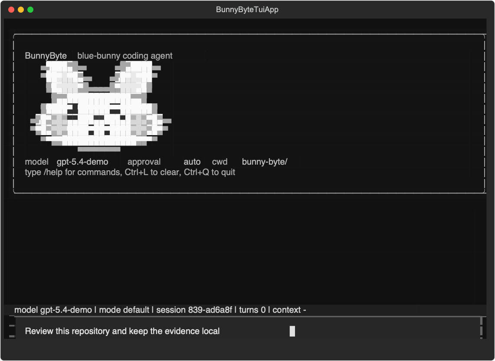
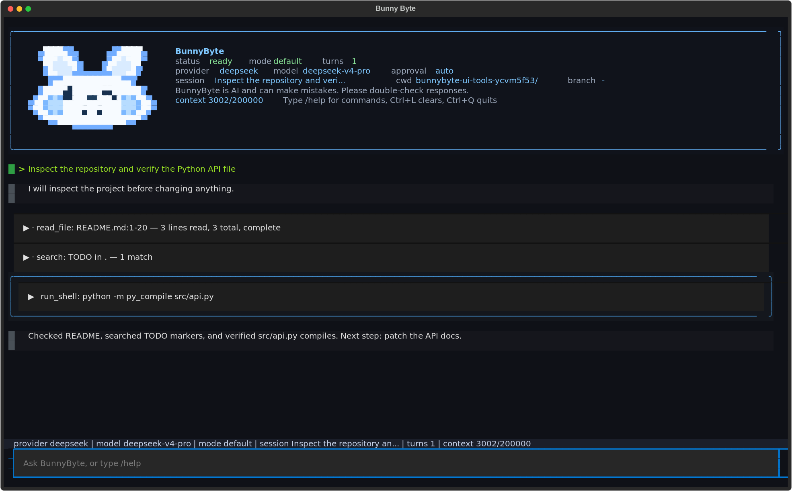
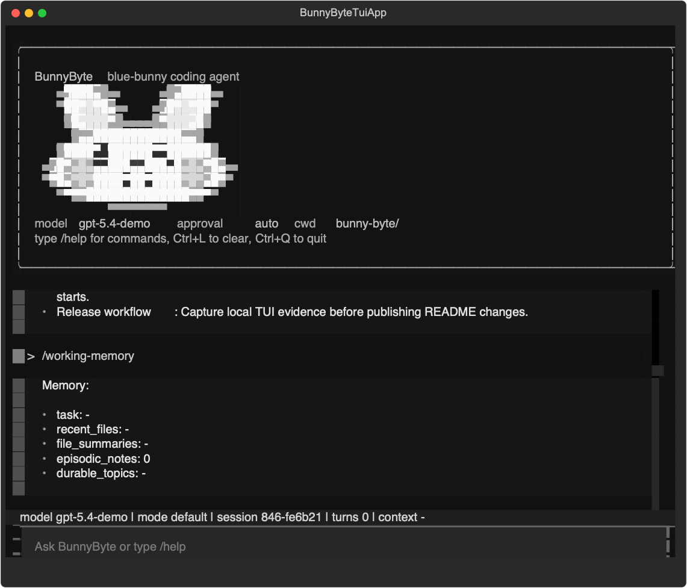
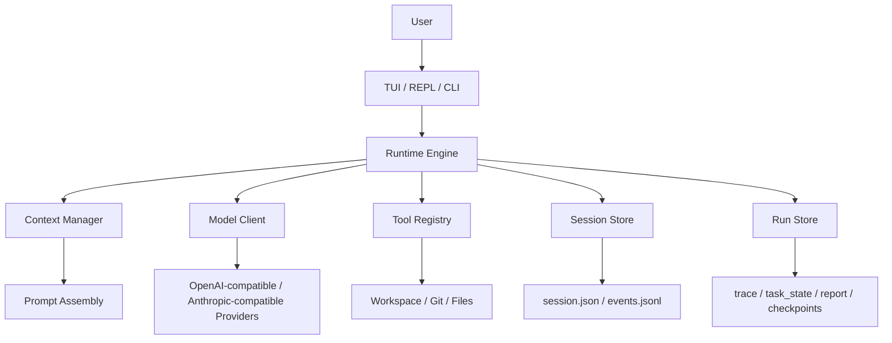

<div align="center">

# Bunny Byte

[中文](README.md) | [English](README.EN.md)

[](https://github.com/LISAooo1234/Bunny-Byte/actions/workflows/ci.yml)

**A terminal coding agent for local repositories**

Bunny Byte provides TUI / REPL / CLI interfaces with controlled tool use,
session recovery, task planning, long-term memory, and local run artifacts.  
The goal is not only to connect a model to a terminal, but to make a local
agent controllable, recoverable, and observable.

</div>

<p align="center">
  
</p>

> BunnyByte is AI and can make mistakes. Please double-check responses.

## Overview

Bunny Byte runs inside a local repository and uses controlled tools for code
search, command execution, file editing, task decomposition, and context
management. Session data, events, traces, checkpoints, reports, and memory are
stored locally for recovery, review, and debugging.

## Core Capabilities

| Capability | Summary |
| --- | --- |
| Model integration | Supports the OpenAI Responses API and Anthropic-style interfaces; `provider` selects configuration and `protocol` selects the request format. |
| Provider failover | When the primary provider returns 5xx / rate limits / timeouts, requests switch to the configured `fallback` chain; the switch is shown in the UI and recorded in the run trace. See [Configuration](docs/configuration.md). |
| Tool calling | Uses provider-native tool calling when available and keeps a fallback path for legacy backends. |
| Session lifecycle | Supports `/history`, `/resume`, `/fork`, `/rollback`, and `/compact`. |
| Undo | `/undo` reverts the files the last turn changed (only those files; it refuses and lists conflicts if you edited them again afterwards). Snapshots live in a private git object store, so even large repos with `node_modules` stay in the millisecond-to-sub-second range. See "Undo and snapshots" below. |
| Task orchestration | Includes plan mode, todo ledger, `ask_user`, and `Explore` / `worker` subagents. |
| Memory | Includes working memory, daily logs, durable topics, `/remember`, and `/dream`. |
| Verification receipts | Before the agent hands in a turn that changed code, the runtime actually runs the project's own tests, feeds failures back for repair, records a pass/fail receipt, and flags answers that claim "tests pass" without any evidence. See "Verification receipts" below. |
| Headless mode | `bunny -p` for scripts and CI: stdout carries only the result (text / json / stream-json) and the exit code says whether the job got done; `--require-verified` ties it to a verification receipt that really ran against the current files. See "Headless mode" below. |
| Project rules | `AGENTS.md`, `CLAUDE.md` and `.bunnybyte/rules/*.md` from the repository are placed in the prompt prefix with their own budget, and a long file is cut with an explicit pointer to read the rest; `bunny doctor` lists what was actually loaded. See "Project rules" below. |
| Stall guard | Cheap models often re-read a file that has not changed. Those "already read" / repeated-call replies no longer eat the step budget. Repeated waste first takes the repeated read-only tool away for a couple of calls, and a model that still loops is asked to report progress without tools and stopped early (`loop_stalled`) instead of burning all 50 steps. |
| Benchmark | `bunny bench` scores the agent with a real model on 8 fixed tasks (pass rate, steps, tokens, wall time) and appends results to `benchmarks/results/`. See [Benchmark](docs/benchmark.md). |
| Safety controls | Supports approval policy, sandboxing, and fresh-read validation before file writes. |
| Run artifacts | Persists session JSON, events JSONL, traces, task state, reports, and checkpoints. |

## Interface

### Tool execution and task flow

<p align="center">
  
</p>

The same interface shows model output, tool calls, command results, and
sub-task state.

### Planning and memory state

<p align="center">
  
</p>

Plan mode can display todo progress, subagent state, and memory-related context
at the same time.

## Architecture



See the full version in [Architecture](docs/architecture.md).

<details>
<summary>Expand architecture preview</summary>

```text
┌────────────────────────────────────────────────────────────────────────────────────┐
│                              ENTRY LAYER (入口层)                                    │
│  ┌──────────┐  ┌──────────┐  ┌──────────┐  ┌──────────┐  ┌──────────────────────┐ │
│  │  bunny   │  │bunnybyte │  │   bb     │  │bunnybyte │  │  bunny "one-shot"    │ │
│  │  (TUI)   │  │  (TUI)   │  │  (TUI)   │  │  --repl  │  │  --resume latest     │ │
│  └────┬─────┘  └────┬─────┘  └────┬─────┘  └────┬─────┘  └──────────┬───────────┘ │
│       └──────────────┴─────────────┴─────────────┘                │              │
│                              │                                     │              │
│                     bunnybyte.cli:main()                            │              │
│                     argparse → runtime.init →                      │              │
│                     TUI / REPL / one-shot 分支                      │              │
└──────────────────────────────────┬─────────────────────────────────────────────────┘
                                   │
                                   ▼
┌────────────────────────────────────────────────────────────────────────────────────┐
│                              CORE RUNTIME (核心运行时)                               │
│                                                                                     │
│  ┌─────────────────────────────────────────────────────────────────────────────┐   │
│  │                          BunnyByte (core/runtime.py)                         │   │
│  │                                                                              │   │
│  │  ┌──────────────┐  ┌──────────────┐  ┌──────────────┐  ┌──────────────────┐ │   │
│  │  │ SessionState │  │ WorkspaceCtx │  │  Permission  │  │  Tool Profiles   │ │   │
│  │  │   Mixin      │  │  (git snapshot│  │   Checker    │  │  (default/plan/  │ │   │
│  │  │              │  │   +docs)     │  │              │  │   readonly/worker)│ │   │
│  │  └──────────────┘  └──────────────┘  └──────────────┘  └──────────────────┘ │   │
│  │                                                                              │   │
│  │  ┌──────────────┐  ┌──────────────┐  ┌──────────────┐  ┌──────────────────┐ │   │
│  │  │  CompactMgr  │  │ ContextMgr   │  │  PlanMode    │  │   WorkerManager  │ │   │
│  │  │  (history    │  │  (prompt     │  │  Controller  │  │   (subagent      │ │   │
│  │  │   compaction)│  │   assembly)  │  │              │  │    lifecycle)    │ │   │
│  │  └──────────────┘  └──────────────┘  └──────────────┘  └──────────────────┘ │   │
│  │                                                                              │   │
│  │  ┌──────────────┐  ┌──────────────┐  ┌──────────────┐  ┌──────────────────┐ │   │
│  │  │  ReadLedger  │  │  TodoLedger  │  │  RunStore    │  │  SessionEventBus │ │   │
│  │  │  (file read  │  │  (task todo  │  │  (evidence   │  │  (event stream   │ │   │
│  │  │   dedup)     │  │   tracking)  │  │   persistence)│  │   persistence)  │ │   │
│  │  └──────────────┘  └──────────────┘  └──────────────┘  └──────────────────┘ │   │
│  │                                                                              │   │
│  │  ┌──────────────────────────────────────────────────────────────────────┐   │   │
│  │  │                    Engine (core/engine.py)                            │   │   │
│  │  │                                                                       │   │   │
│  │  │   run_turn() ─── 生成器，每次 yield 一个事件                           │   │   │
│  │  │                                                                       │   │   │
│  │  │   ┌──────────────────────────────────────────────────────────────┐   │   │   │
│  │  │   │                  TURN CONTROL LOOP                           │   │   │   │
│  │  │   │                                                              │   │   │   │
│  │  │   │   1. ContextManager 组装 prompt                              │   │   │   │
│  │  │   │   2. Provider Client 发起请求 (流式)                          │   │   │   │
│  │  │   │   3. 解析返回 (原生 tool call / 文本 <tool>/<final>)          │   │   │   │
│  │  │   │   4. ToolExecutor 执行工具 (含 policy + permission 检查)      │   │   │   │
│  │  │   │   5. 结果追加到 history，循环直到 <final> 或达到步数上限      │   │   │   │
│  │  │   │                                                              │   │   │   │
│  │  │   └──────────────────────────────────────────────────────────────┘   │   │   │
│  │  └──────────────────────────────────────────────────────────────────────┘   │   │
│  └─────────────────────────────────────────────────────────────────────────────┘   │
└────────────────────────────────────────────────────────────────────────────────────┘
                                   │
                                   ▼
┌────────────────────────────────────────────────────────────────────────────────────┐
│                              INFRASTRUCTURE (基础设施层)                             │
│                                                                                     │
│  ┌──────────────┐  ┌──────────────┐  ┌──────────────┐  ┌──────────────────────┐   │
│  │  Providers   │  │    Tools     │  │   Memory     │  │      Skills          │   │
│  │  (API适配)   │  │  (工具系统)   │  │  (记忆系统)   │  │     (技能系统)        │   │
│  └──────────────┘  └──────────────┘  └──────────────┘  └──────────────────────┘   │
│  ┌──────────────┐  ┌──────────────┐  ┌──────────────┐  ┌──────────────────────┐   │
│  │   Sandbox    │  │  Evaluation  │  │   Testing    │  │    Evidence          │   │
│  │  (安全隔离)   │  │  (评估系统)   │  │  (脚本化测试) │  │   (审计证据)          │   │
│  └──────────────┘  └──────────────┘  └──────────────┘  └──────────────────────┘   │
└────────────────────────────────────────────────────────────────────────────────────┘
```

</details>

Rough code mapping:

- [`bunnybyte/tui/`](bunnybyte/tui/): Textual terminal interface
- [`bunnybyte/core/`](bunnybyte/core/): runtime, engine, context, session, checkpoints, workers
- [`bunnybyte/tools/`](bunnybyte/tools/): tool registry, schemas, execution entrypoints
- [`bunnybyte/features/`](bunnybyte/features/): memory, skills, sandbox
- [`bunnybyte/providers/`](bunnybyte/providers/): model provider clients
- [`bunnybyte/evaluation/`](bunnybyte/evaluation/): evaluation and run evidence

## Quick Start

Requirements: `Python 3.10+`, `git`, and at least one usable model provider
key.

### Install

```bash
curl -fsSL https://raw.githubusercontent.com/LISAooo1234/Bunny-Byte/main/install.sh | bash
```

Then initialize provider settings:

```bash
bunny setup
bunny doctor
bunny
```

`bunny doctor` checks Python, config files, provider/model/API key (only the last 4 characters are shown), live connectivity, the git repo, the sandbox backend and ripgrep, and flags `.bunnybyte.toml` / `.env` files tracked by git that could leak keys. Every failing check comes with an actionable fix; `--offline` skips the network request, `--json` is meant for scripts and CI, and the exit code is 1 when any check fails.

### Source setup

```bash
git clone https://github.com/LISAooo1234/Bunny-Byte.git
cd Bunny-Byte
uv sync --dev
uv run bunny
```

Available entrypoints:

```bash
bunny
bunnybyte
bb
bunnybyte-tui
bbtui
```

## Common Commands

### CLI

```bash
bunny
bunny --resume latest
bunny --repl
bunny "Fix the first failing test in the current repository"
bunny doctor            # environment self-check
bunny -p "Fix the failing tests" --approval auto --require-verified   # headless, exit code tied to a verification receipt
bunny bench             # live benchmark (calls the real model)
```

### TUI Slash Commands

- `/help`
- `/history`
- `/resume latest`
- `/fork <event|turn|#>`
- `/rollback <event|turn|#>`
- `/undo`, `/undo list`, `/undo --force`
- `/hooks`, `/hooks trust`
- `/plan <topic>`
- `/plan-exit`
- `/skills`
- `/tool [name]`
- `/memory`
- `/working-memory`
- `/dream`

## Benchmark

Bunny Byte ships a live benchmark. `bunny bench` has a real model solve 8 tasks in throwaway git repositories (fix a failing test, implement a function from its docstring, rename across files, add a CLI flag, answer a read-only codebase question, recover from a rejected patch, ...). A shell verifier, including hidden tests that only exist at grading time, decides each result. The command reports pass rate, clean-finish rate, average steps, tokens and wall time, and appends a result file tagged with version, git commit, model and task-set fingerprint to `benchmarks/results/`, so the score history is public.

First baseline (0.5.0, `deepseek-v4-flash`, 2 runs per task, step ceiling 50): 16/16 passed and 15/16 finished cleanly, but only 4/16 runs stayed within the efficient step budget: 19.7 steps on average against 2-5 for the reference solutions, and one run needed all 50 steps. The bottleneck is not whether the model can solve the task but that it keeps going after the work is done; that is exactly what the upcoming step-budget refund and verification receipts will be measured against.

With the stall guard (same task set, 2 runs per task, captured from an uncommitted working tree): still 16/16 passed; 0 of 16 runs hit the step ceiling (baseline: 1) and 1 run was ended early as stalled. Average model calls went 14.3 → 12.7 and total wall time 366s → 327s, but 16 runs are noisy and neither is a conclusion. Uncached input tokens actually rose 378k → 459k (about 25.9k → 30.7k tokens per passed task), so this is not a cost-saving feature. What is solid: the bench now counts repeated or no-new-information tool calls as wasted steps, 5.6 per task on average, about 30% of all steps, so the cheap model's waste is mostly re-reading rather than being unable to solve the task. Full results are in [`benchmarks/results/`](benchmarks/results/).

There are 10 tasks, so one task is 10 percentage points and a single run can move by one task as noise; average steps and tokens are the more sensitive regression signals. The historical numbers above come from the original 8 tasks (a different task-set hash, so they are never compared with newer results). The 2 newer "ripple" tasks are traps built on purpose (the obvious fix breaks a test the prompt did not name) to exercise the verification gate; on `deepseek-v4-flash` they passed 12/12 even without the gate (the trap did not bite that model), but on `Claude Haiku 4.5` `change_default_everywhere` went 0/5 without the gate and 4/4 with it (see "Verification receipts" below). Details: [Benchmark](docs/benchmark.md) (Chinese).

## Undo and snapshots

- `/undo` restores the files the latest agent turn changed to how they were before that turn; run it again to step back one more turn. `/undo list` shows every turn, the files it touched, and whether it was already undone.
- Only files that turn touched are restored; files you created yourself or the agent never touched stay as they are. If a file the turn changed was modified again after the turn ended (for example by you), **nothing is written**, and the conflicting files are listed; use `/undo --force` to overwrite them.
- After an undo, a system note tells the model that those files are back to their earlier content, so it does not assume what it just wrote is still there. If git's HEAD moved during the turn (a commit or branch switch) you get a reminder that undo restores working-tree files only, not commits. Undo is refused while a subagent is running.
- Snapshots live in `.bunnybyte/shadow.git`, a private git object store driven through `GIT_DIR` (your own repository's index, refs, config and hooks are never touched). A snapshot is a git tree; `git add -A` through a private index only re-hashes files whose stat data changed, so the cost follows the number of changed files rather than the size of the repository. `.gitignore` is honored; `node_modules`, `.mypy_cache`, `.tox` and `.nox` are always skipped, and new untracked files over 8 MB are left out. CRLF, file modes, symlinks and non-ASCII paths round-trip byte for byte.
- It also fixes a real performance problem: every tool call used to hash the whole workspace twice, and every checkpoint copied the whole workspace (silently giving up on rollback above 20 MB). In a repo with 800 source files plus a 15,000-file `node_modules`, a turn that writes one file went from 18.3 s of snapshot overhead and 187 MB of checkpoint copies to 0.6 s and under 1 MB. `/rollback` now restores from snapshot trees too, without the 20 MB cap; copy-style checkpoints written by older versions can still be rolled back (`.bunnybyte/checkpoints/*/workspace` can be deleted by hand).
- Limits: files ignored by `.gitignore` are not in the snapshot, except explicit `write_file` / `patch_file` targets; changes a shell command makes to ignored paths such as `dist/` or `.env` cannot be undone and do not count as changed files for the turn. A workspace that contains a nested git repository (submodules, cloned dependencies), or has no git, falls back to per-file hashing (dependency directories skipped, unchanged files cached) and `/undo` is unavailable (`bunny doctor` warns when git is missing). `.bunnybyte/shadow.git` is not cleaned up automatically; delete it to reset (undo history is lost). `/rollback` to an older checkpoint never deletes files hidden by `.gitignore` (it only overwrites their content); once a nested repository is detected a `.bunnybyte/shadow.git/DISABLED` marker stops further attempts (delete `.bunnybyte/shadow.git` to reset); files a background subagent writes after the turn ended do not belong to that turn. Set `BUNNYBYTE_SHADOW=off` to disable the whole mechanism.

## Verification receipts

Cheap models love to say "tests pass" without running anything. Bunny Byte makes "verify before you hand in" a runtime rule instead of a sentence in the prompt.

**Measured** (`bunny bench`, `Claude Haiku 4.5`, trap task `change_default_everywhere`: the prompt names one failing test and the obvious fix breaks a test it did not name): **0/5** passed without the gate, and in 3 of those runs the final answer claimed the work was verified; **4/4** passed with the gate, each time because the gate ran the whole suite, saw the other test fail, fed the output back, and the model fixed it. The price is roughly double the steps and tokens (7.8 → 14.3 steps, about 76k → 150k input tokens per run). The sample is small (one task, one model, 4-5 runs per condition), and for a model that already runs the whole suite on its own (`deepseek-v4-flash`, 12/12 without the gate) it buys nothing: it catches models that stop after running only the test they were told about. Offline tests with a scripted model prove the same causal chain.

What the runtime does:

- When the model is about to give its final answer and the turn changed code, the runtime runs the project's checks: `[verify].commands` if configured, otherwise detected from what changed (pytest or unittest, `npm test`, or a `compileall` syntax check for Python projects without tests; pytest projects run the tests related to the change first so failures surface sooner).
- On failure the output tail is written back into the session as a `verify` entry, the final answer is held back and the model keeps repairing (1 round by default, `max_repair_rounds`). The check does not consume `max_steps`. If the failure predates the change, the model may say so in its answer instead of editing.
- Every command leaves a receipt (command, exit code, duration, redacted output tail, round) in `task_state`, `report.json` and the trace; the UI shows a pass/fail card and a one-line summary.
- If the answer says "tests pass / verified" but the turn has no passing receipt and the model never ran a test command successfully itself, a warning line is appended.
- Default mode `ask` follows the approval policy (`--approval auto` runs it, `ask` prompts first, `never` skips); `auto` never asks; `off` disables it. It only applies to the main agent: subagents, plan mode, read-only mode and docs-only changes never trigger it.
- A timed-out command kills its whole process group (no stray pytest/jest children) and runs with `CI=1` so watch modes do not hang.
- If the test files are plain assert-scripts run as `python test_x.py` (no unittest / pytest), they are run directly (up to 3, the ones related to the change first) instead of unittest collecting 0 tests and the gate ending "skipped".
- When deciding whether the model ran the tests itself, the exit code only counts for a test command that ran last and was not piped: the 0 of `pytest | tail`, `pytest; echo done` or `pytest || true` belongs to another command and is accepted only when the output has an unambiguous "all passed" summary.

```toml
# .bunnybyte.toml
[verify]
mode = "ask"                       # off | ask | auto; override with --verify
commands = ["pytest -q", "ruff check ."]   # omit to auto-detect
timeout = 120                      # per-command seconds
max_repair_rounds = 1              # repair attempts after a failed check
```

## Headless mode

`bunny -p` (`--print`) plugs Bunny Byte into scripts and CI: no UI, no questions, no banner. stdout carries only the result, and **the exit code says whether the job really got done**.

```bash
bunny -p "Fix the failing test in test_calc.py" --approval auto
bunny -p "Explain this error" - < error.log      # a lone `-` appends stdin to the prompt; with no prompt argument stdin is the prompt
bunny -p "Fix the failing tests" --approval auto --require-verified && git commit -am "fix"
bunny -p "Summarize recent changes" --output-format json | jq .result
```

| Exit code | Meaning |
| --- | --- |
| 0 | Finished normally |
| 1 | Run error (model/provider error, exception) |
| 2 | Usage or config error (no prompt, `--require-verified` with `--verify off`, invalid config) |
| 3 | Stopped early: step limit, stall guard, retry limit |
| 4 | Only with `--require-verified` (3 outranks 4: a run that stopped early never reports 4): code changed but there is no passing receipt covering the **current file contents** (verification failed / timed out / declined / unavailable / never ran, or files changed after it) |
| 5 | An `on_final` hook still blocks the final answer after its feedback rounds ran out (see [Hooks](#hooks); `hooks.final_blocked` is true in the JSON result) |
| 130 | Interrupted with Ctrl-C |

- `--require-verified` ties the exit code to the verification receipt: not "the model says tests pass" but the runtime actually ran them against the current version of the files. It implies `--verify auto` and cannot be combined with `--verify off|ask` (exit 2); runs that changed nothing or only docs need no verification (exit 0); files changed by worker subagents count as changes of the run; when no check can be detected, set `[verify].commands` in `.bunnybyte.toml`. The receipt commands come from your project, so only use it in repositories you trust.
- `--output-format text` (default): stdout is just the final answer; progress (`› read_file ...`) and verification notices go to stderr, `-q` silences them. `json`: stdout is one result object with `ok`, `exit_code`, `result`, `status`, `stop_reason`, `session_id`, `run_id`, `model`, `tool_steps`, `wasted_steps`, `permission_denials`, `duration_ms`, `usage` (input/output/cached tokens, `null` when the provider reports none), `changed_paths`, `verification` (`verdict`, `status`, `commands`, `repairs`) and `hooks` (`final_blocked`, `runs`). `stream-json`: one event per line (`system` init line, `tool_call`, `tool_result`, `runtime_notice`, `final`, ...) and the same result object as the last line.
- It never waits for a human: approval policy `ask` behaves like `never` (writes and shell commands are denied, the count lands in `permission_denials` and a note on stderr), so pass `--approval auto` to allow them; unless the policy is `auto` only read-only Explore subagents may be started (write-capable workers carry their own approval and would bypass the denial); the `ask_user` tool is unavailable; background learning (auto dream, skill evolution) is off.
- With a prompt argument stdin is not read (a stdin inherited from cron or another agent's tool shell may be a pipe that never closes); it is read only when there is no prompt argument or the arguments contain a lone `-` (input beyond 200k characters is truncated, with a note on stderr).
- Slash commands and skill invocations are not supported (`bunny -p "/status"` exits 2; describe the task in plain language); a prompt that starts with a path such as `/tmp/app.py has a bug` is fine. It combines with `--resume latest`, `--cwd`, `--provider` and the other flags; startup errors such as an unknown `--resume` session exit 2, and with a json format stdout still carries one result object with an `error` field. `--output-format`, `-q` and `--require-verified` are errors without `-p`.

## Project rules

Write the team's conventions into the repository and the agent sees them every turn:

- Reads `AGENTS.md`, `CLAUDE.md` and `.bunnybyte/rules/*.md` (sorted by name), first from the repository root and then from the sub-directory you launched in, so sub-directory rules come later and are more specific. Files with identical content are loaded once (for example `AGENTS.md` symlinked to `CLAUDE.md`).
- Rules have their own budget: 6000 characters per file and 12000 in total. Anything beyond that is cut at a line boundary and the prompt says how much was cut and which file to `read_file` for the rest, instead of silently clipping `AGENTS.md` to 1200 characters as before.
- Rules sit near the front of the prompt prefix, before the tool list. Under context pressure the prefix is trimmed from its tail, so rules are touched last. Editing a rule file rebuilds the prefix automatically.
- The "项目规则" row of `bunny doctor` lists the files that were really loaded and warns when one was cut.
- Rules are advisory text: they never widen tool permissions or skip approvals. But they are part of the system prompt and weigh more than a README: `AGENTS.md`, `CLAUDE.md` and `.bunnybyte/rules/` from a cloned repository are injected automatically, so look at them before running the agent in a repository you do not trust.
- `.bunnybyte/` is usually gitignored (it holds runtime data); to share `rules/` with your team, ignore `.bunnybyte/*` and add `!.bunnybyte/rules/` (git cannot re-include a sub-directory of an ignored directory, so ignoring `.bunnybyte/` itself will not work).

## Hooks

Put a few shell commands in `.bunnybyte.toml` and turn team rules into something the runtime **enforces**, instead of hoping the model follows the prompt:

```toml
[[hooks.pre_tool]]                      # before a tool runs: exit 2 = block; the reason goes to the model, no approval prompt
match = "write_file|patch_file"
command = "python3 .bunnybyte/hooks/guard.py"

[[hooks.post_tool]]                     # after a file write: format it; exit 2 feeds lint errors back to the model
match = "write_file|patch_file"
command = "ruff format --quiet . && ruff check --quiet . || exit 2"

[[hooks.on_final]]                      # when the model wants to finish: exit 2 holds the answer back and sends the reason to the model
command = "python3 .bunnybyte/hooks/before_done.py"
only_if_changed = true
```

- A hook reads JSON on stdin (field names are modelled on Claude Code hooks, but tool names and path fields differ, so existing scripts need adapting; the differences are listed in the docs); its environment is filtered, so API keys do not leak into it.
- Files a formatter hook touches still count as changed in that turn: `/undo` reverts them and the verification gate sees them.
- **Hooks from the repository do not run by default**: a cloned `.bunnybyte.toml` could hide any command. Startup warns, `/hooks` lists them, `/hooks trust` enables them after you have read them, and any change to the hook config revokes that trust. Unattended runs use `BUNNYBYTE_TRUST_HOOKS=1`, or keep hooks in the global config.
- A hook that crashes or times out is allowed through with a warning by default; use `on_error = "block"` for a real safety gate. Every run is recorded in the trace and `report.json`, and `bunny doctor` has a "钩子" row.
- Subagents obey `pre_tool` / `post_tool` too.

The full protocol, exit-code table, limits and four ready-made recipes are in [docs/hooks.md](docs/hooks.md) (Chinese).

## Repository Layout

```text
bunnybyte/
├── core/        # runtime, engine, context, session, checkpoints, workers
├── tools/       # built-in tools and registration
├── tui/         # Textual terminal interface
├── features/    # memory, skills, sandbox
├── providers/   # model provider clients
├── bench/       # bunny bench live benchmark
└── evaluation/  # evaluation and run artifacts

docs/
├── configuration.md
├── skills.md
├── memory.md
├── sandbox.md
└── benchmark.md

tests/           # runtime / safety / TUI / acceptance / regression tests
```

## Documentation

- [Configuration](docs/configuration.md)
- [Architecture](docs/architecture.md)
- [Skills](docs/skills.md)
- [Memory](docs/memory.md)
- [Sandbox](docs/sandbox.md)
- [Benchmark](docs/benchmark.md) (Chinese)
- [Hooks](docs/hooks.md) (Chinese)
