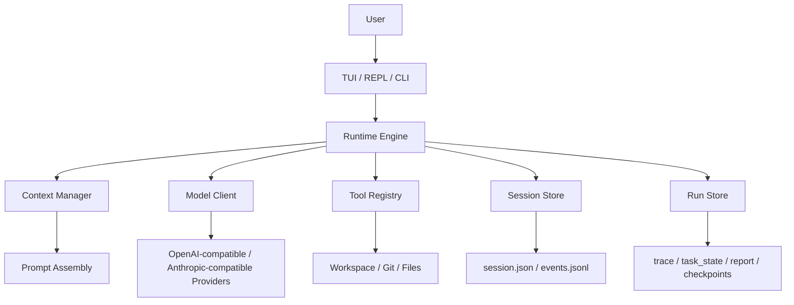

<div align="center">

# Bunny Byte

[中文](README.md) | [English](README.EN.md)

**A terminal coding agent for local repositories**

Bunny Byte provides TUI / REPL / CLI interfaces with controlled tool use,
session recovery, task planning, long-term memory, and local run artifacts.  
The goal is not only to connect a model to a terminal, but to make a local
agent controllable, recoverable, and observable.

</div>

<p align="center">
  
</p>

> BunnyByte is AI and can make mistakes. Please double-check responses.

## Overview

Bunny Byte runs inside a local repository and uses controlled tools for code
search, command execution, file editing, task decomposition, and context
management. Session data, events, traces, checkpoints, reports, and memory are
stored locally for recovery, review, and debugging.

## Core Capabilities

| Capability | Summary |
| --- | --- |
| Model integration | Supports the OpenAI Responses API and Anthropic-style interfaces; `provider` selects configuration and `protocol` selects the request format. |
| Tool calling | Uses provider-native tool calling when available and keeps a fallback path for legacy backends. |
| Session lifecycle | Supports `/history`, `/resume`, `/fork`, `/rollback`, and `/compact`. |
| Task orchestration | Includes plan mode, todo ledger, `ask_user`, and `Explore` / `worker` subagents. |
| Memory | Includes working memory, daily logs, durable topics, `/remember`, and `/dream`. |
| Safety controls | Supports approval policy, sandboxing, and fresh-read validation before file writes. |
| Run artifacts | Persists session JSON, events JSONL, traces, task state, reports, and checkpoints. |

## Interface

### Tool execution and task flow

<p align="center">
  
</p>

The same interface shows model output, tool calls, command results, and
sub-task state.

### Planning and memory state

<p align="center">
  
</p>

Plan mode can display todo progress, subagent state, and memory-related context
at the same time.

## Architecture



See the full version in [Architecture](docs/architecture.md).

<details>
<summary>Expand architecture preview</summary>

```text
┌────────────────────────────────────────────────────────────────────────────────────┐
│                              ENTRY LAYER (入口层)                                    │
│  ┌──────────┐  ┌──────────┐  ┌──────────┐  ┌──────────┐  ┌──────────────────────┐ │
│  │  bunny   │  │bunnybyte │  │   bb     │  │bunnybyte │  │  bunny "one-shot"    │ │
│  │  (TUI)   │  │  (TUI)   │  │  (TUI)   │  │  --repl  │  │  --resume latest     │ │
│  └────┬─────┘  └────┬─────┘  └────┬─────┘  └────┬─────┘  └──────────┬───────────┘ │
│       └──────────────┴─────────────┴─────────────┘                │              │
│                              │                                     │              │
│                     bunnybyte.cli:main()                            │              │
│                     argparse → runtime.init →                      │              │
│                     TUI / REPL / one-shot 分支                      │              │
└──────────────────────────────────┬─────────────────────────────────────────────────┘
                                   │
                                   ▼
┌────────────────────────────────────────────────────────────────────────────────────┐
│                              CORE RUNTIME (核心运行时)                               │
│                                                                                     │
│  ┌─────────────────────────────────────────────────────────────────────────────┐   │
│  │                          BunnyByte (core/runtime.py)                         │   │
│  │                                                                              │   │
│  │  ┌──────────────┐  ┌──────────────┐  ┌──────────────┐  ┌──────────────────┐ │   │
│  │  │ SessionState │  │ WorkspaceCtx │  │  Permission  │  │  Tool Profiles   │ │   │
│  │  │   Mixin      │  │  (git snapshot│  │   Checker    │  │  (default/plan/  │ │   │
│  │  │              │  │   +docs)     │  │              │  │   readonly/worker)│ │   │
│  │  └──────────────┘  └──────────────┘  └──────────────┘  └──────────────────┘ │   │
│  │                                                                              │   │
│  │  ┌──────────────┐  ┌──────────────┐  ┌──────────────┐  ┌──────────────────┐ │   │
│  │  │  CompactMgr  │  │ ContextMgr   │  │  PlanMode    │  │   WorkerManager  │ │   │
│  │  │  (history    │  │  (prompt     │  │  Controller  │  │   (subagent      │ │   │
│  │  │   compaction)│  │   assembly)  │  │              │  │    lifecycle)    │ │   │
│  │  └──────────────┘  └──────────────┘  └──────────────┘  └──────────────────┘ │   │
│  │                                                                              │   │
│  │  ┌──────────────┐  ┌──────────────┐  ┌──────────────┐  ┌──────────────────┐ │   │
│  │  │  ReadLedger  │  │  TodoLedger  │  │  RunStore    │  │  SessionEventBus │ │   │
│  │  │  (file read  │  │  (task todo  │  │  (evidence   │  │  (event stream   │ │   │
│  │  │   dedup)     │  │   tracking)  │  │   persistence)│  │   persistence)  │ │   │
│  │  └──────────────┘  └──────────────┘  └──────────────┘  └──────────────────┘ │   │
│  │                                                                              │   │
│  │  ┌──────────────────────────────────────────────────────────────────────┐   │   │
│  │  │                    Engine (core/engine.py)                            │   │   │
│  │  │                                                                       │   │   │
│  │  │   run_turn() ─── 生成器，每次 yield 一个事件                           │   │   │
│  │  │                                                                       │   │   │
│  │  │   ┌──────────────────────────────────────────────────────────────┐   │   │   │
│  │  │   │                  TURN CONTROL LOOP                           │   │   │   │
│  │  │   │                                                              │   │   │   │
│  │  │   │   1. ContextManager 组装 prompt                              │   │   │   │
│  │  │   │   2. Provider Client 发起请求 (流式)                          │   │   │   │
│  │  │   │   3. 解析返回 (原生 tool call / 文本 <tool>/<final>)          │   │   │   │
│  │  │   │   4. ToolExecutor 执行工具 (含 policy + permission 检查)      │   │   │   │
│  │  │   │   5. 结果追加到 history，循环直到 <final> 或达到步数上限      │   │   │   │
│  │  │   │                                                              │   │   │   │
│  │  │   └──────────────────────────────────────────────────────────────┘   │   │   │
│  │  └──────────────────────────────────────────────────────────────────────┘   │   │
│  └─────────────────────────────────────────────────────────────────────────────┘   │
└────────────────────────────────────────────────────────────────────────────────────┘
                                   │
                                   ▼
┌────────────────────────────────────────────────────────────────────────────────────┐
│                              INFRASTRUCTURE (基础设施层)                             │
│                                                                                     │
│  ┌──────────────┐  ┌──────────────┐  ┌──────────────┐  ┌──────────────────────┐   │
│  │  Providers   │  │    Tools     │  │   Memory     │  │      Skills          │   │
│  │  (API适配)   │  │  (工具系统)   │  │  (记忆系统)   │  │     (技能系统)        │   │
│  └──────────────┘  └──────────────┘  └──────────────┘  └──────────────────────┘   │
│  ┌──────────────┐  ┌──────────────┐  ┌──────────────┐  ┌──────────────────────┐   │
│  │   Sandbox    │  │  Evaluation  │  │   Testing    │  │    Evidence          │   │
│  │  (安全隔离)   │  │  (评估系统)   │  │  (脚本化测试) │  │   (审计证据)          │   │
│  └──────────────┘  └──────────────┘  └──────────────┘  └──────────────────────┘   │
└────────────────────────────────────────────────────────────────────────────────────┘
```

</details>

Rough code mapping:

- [`bunnybyte/tui/`](bunnybyte/tui/): Textual terminal interface
- [`bunnybyte/core/`](bunnybyte/core/): runtime, engine, context, session, checkpoints, workers
- [`bunnybyte/tools/`](bunnybyte/tools/): tool registry, schemas, execution entrypoints
- [`bunnybyte/features/`](bunnybyte/features/): memory, skills, sandbox
- [`bunnybyte/providers/`](bunnybyte/providers/): model provider clients
- [`bunnybyte/evaluation/`](bunnybyte/evaluation/): evaluation and run evidence

## Quick Start

Requirements: `Python 3.10+`, `git`, and at least one usable model provider
key.

### Install

```bash
curl -fsSL https://raw.githubusercontent.com/LISAooo1234/Bunny-Byte/main/install.sh | bash
```

Then initialize provider settings:

```bash
bunny setup
bunny
```

### Source setup

```bash
git clone https://github.com/LISAooo1234/Bunny-Byte.git
cd Bunny-Byte
uv sync --dev
uv run bunny
```

Available entrypoints:

```bash
bunny
bunnybyte
bb
bunnybyte-tui
bbtui
```

## Common Commands

### CLI

```bash
bunny
bunny --resume latest
bunny --repl
bunny "Fix the first failing test in the current repository"
```

### TUI Slash Commands

- `/help`
- `/history`
- `/resume latest`
- `/fork <event|turn|#>`
- `/rollback <event|turn|#>`
- `/plan <topic>`
- `/plan-exit`
- `/skills`
- `/tool [name]`
- `/memory`
- `/working-memory`
- `/dream`

## Repository Layout

```text
bunnybyte/
├── core/        # runtime, engine, context, session, checkpoints, workers
├── tools/       # built-in tools and registration
├── tui/         # Textual terminal interface
├── features/    # memory, skills, sandbox
├── providers/   # model provider clients
└── evaluation/  # evaluation and run artifacts

docs/
├── configuration.md
├── skills.md
├── memory.md
└── sandbox.md

tests/           # runtime / safety / TUI / acceptance / regression tests
```

## Documentation

- [Configuration](docs/configuration.md)
- [Architecture](docs/architecture.md)
- [Skills](docs/skills.md)
- [Memory](docs/memory.md)
- [Sandbox](docs/sandbox.md)
