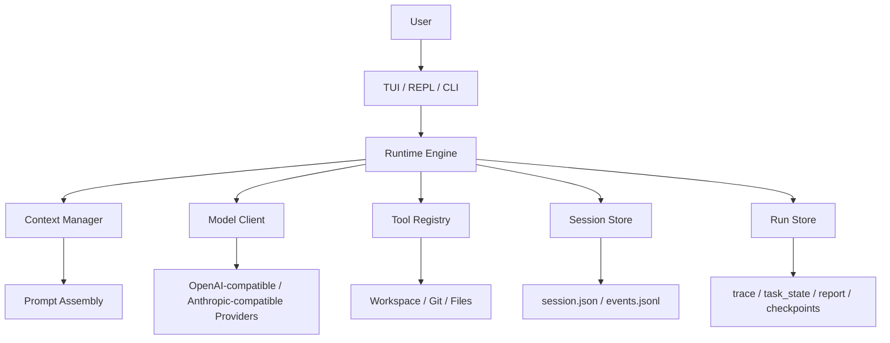

<div align="center">

# Bunny Byte

[中文](README.md) | [English](README.EN.md)

[](https://github.com/LISAooo1234/Bunny-Byte/actions/workflows/ci.yml)

**面向本地代码仓库的终端 Coding Agent**

Bunny Byte 提供 TUI / REPL / CLI 三种交互方式，支持受控工具调用、会话恢复、任务规划、长期记忆和本地运行留痕。  
项目重点不是“把模型接到终端”，而是把本地 Agent 的可控性、可恢复性和可观察性做完整。

</div>

<p align="center">
  
</p>

> BunnyByte is AI and can make mistakes. Please double-check responses.

## 概述

Bunny Byte 运行在本地仓库中，通过受控工具完成代码检索、命令执行、文件修改、任务拆解与上下文管理。  
运行过程中产生的 session、event、trace、checkpoint、report 和 memory 数据都会保存在本地，便于恢复、审计和复盘。

## 核心能力

| 能力 | 说明 |
| --- | --- |
| 模型接入 | 支持 OpenAI Responses API 与 Anthropic 风格接口；`provider` 负责配置选择，`protocol` 负责请求协议。 |
| 故障切换 | 主 provider 5xx / 限流 / 超时时自动改用 `fallback` 备用链，切换过程写入 trace 并在界面提示；详见 [配置](docs/configuration.md)。 |
| 工具调用 | 优先使用 provider 原生 tool calling；同时保留兼容旧后端的 fallback。 |
| 会话管理 | 支持 `/history`、`/resume`、`/fork`、`/rollback`、`/compact`。 |
| 撤销 | `/undo` 把最近一轮对文件的改动还原（只动那一轮改过的文件，之后你又改过会拒绝并列出冲突）；快照放在私有的 git 对象库里，大仓库（含 `node_modules`）也是毫秒到亚秒级；详见下文「撤销与快照」。 |
| 任务编排 | 支持 plan mode、todo ledger、`ask_user`、`Explore` / `worker` 子 agent。 |
| 记忆系统 | 提供 working memory、daily logs、durable topics，以及 `/remember`、`/dream`。 |
| 验证回执 | 改完代码、准备交卷前，运行时真正跑一遍项目自己的测试；失败就把输出塞回去让模型修，最后给出 ✓/✗ 回执，并拦下“声称测试通过却没跑过”的回答；详见下文「验证回执」。 |
| 无人值守 | `bunny -p` 给脚本和 CI 用：stdout 只出结果（text / json / stream-json），退出码说明做完没有；`--require-verified` 让退出码绑定“真的跑过且覆盖当前文件的验证回执”；详见下文「无人值守模式」。 |
| 项目规则 | 仓库里的 `AGENTS.md`、`CLAUDE.md`、`.bunnybyte/rules/*.md` 会放进提示词前缀，有独立预算，超长时明确提示去读原文件；`bunny doctor` 会列出实际读到了哪些；详见下文「项目规则」。 |
| 空转保护 | 便宜模型常反复读同一个没变的文件。这类“已读/重复调用”不再占用步数预算；连续空转时先暂时收走被重复的只读工具，仍不改就让它不带工具汇报进展并提前收尾（`loop_stalled`），避免烧光 50 步。 |
| 跑分基准 | `bunny bench` 用真实模型在 10 个固定任务上打分（通过率、步数、token、耗时），结果与历史写入 `benchmarks/results/`；详见 [跑分基准](docs/benchmark.md)。 |
| 安全控制 | 支持 approval policy、sandbox，以及写文件前 fresh read 校验。 |
| 运行留痕 | 落地 session JSON、events JSONL、trace、task state、report、checkpoint。 |

## 界面示例

### 工具执行与任务过程

<p align="center">
  
</p>

同一界面内可以查看模型输出、工具调用、命令执行结果和子任务状态。

界面布局（0.6.x 起）：欢迎横幅只在空会话时显示，发出第一条消息（或用 `--resume` 恢复有历史的会话）后收成一行标题，`/banner` 可随时展开/收起；底部状态栏分段显示运行状态与本轮耗时、模型、模式、上下文占用（百分比 + 迷你条，超过 50%/80% 变黄/变红）、本轮 token（↑ 最后一次请求的输入、↓ 本轮输出之和；provider 不上报时显示 `-`）、子 agent 数和按键提示，窗口变窄时先丢次要分段。工具卡片统一为一行：`✓ 读取 calc.py:1-50 · 全部 2 行 · 13ms`，`run_shell` 显示退出码（非 0 标红），`patch_file` / `write_file` 直接内联彩色 diff（短 diff 自动展开，长 diff 截断并注明剩余行数），验证回执是单独配色的 ✓/✗ 卡片；审批模式下批准 `patch_file` 前就能看到 diff。`Ctrl+O` 一次展开/收起全部工具卡片。截图仍是旧版界面，待更新。

### 计划模式与记忆状态

<p align="center">
  
</p>

计划模式下可以同步查看 todo 进度、子 agent 状态和 memory 相关信息。

## 架构



完整版本见 [Architecture](docs/architecture.md)。

<details>
<summary>展开查看完整架构图预览</summary>

```text
┌────────────────────────────────────────────────────────────────────────────────────┐
│                              ENTRY LAYER (入口层)                                    │
│  ┌──────────┐  ┌──────────┐  ┌──────────┐  ┌──────────┐  ┌──────────────────────┐ │
│  │  bunny   │  │bunnybyte │  │   bb     │  │bunnybyte │  │  bunny "one-shot"    │ │
│  │  (TUI)   │  │  (TUI)   │  │  (TUI)   │  │  --repl  │  │  --resume latest     │ │
│  └────┬─────┘  └────┬─────┘  └────┬─────┘  └────┬─────┘  └──────────┬───────────┘ │
│       └──────────────┴─────────────┴─────────────┘                │              │
│                              │                                     │              │
│                     bunnybyte.cli:main()                            │              │
│                     argparse → runtime.init →                      │              │
│                     TUI / REPL / one-shot 分支                      │              │
└──────────────────────────────────┬─────────────────────────────────────────────────┘
                                   │
                                   ▼
┌────────────────────────────────────────────────────────────────────────────────────┐
│                              CORE RUNTIME (核心运行时)                               │
│                                                                                     │
│  ┌─────────────────────────────────────────────────────────────────────────────┐   │
│  │                          BunnyByte (core/runtime.py)                         │   │
│  │                                                                              │   │
│  │  ┌──────────────┐  ┌──────────────┐  ┌──────────────┐  ┌──────────────────┐ │   │
│  │  │ SessionState │  │ WorkspaceCtx │  │  Permission  │  │  Tool Profiles   │ │   │
│  │  │   Mixin      │  │  (git snapshot│  │   Checker    │  │  (default/plan/  │ │   │
│  │  │              │  │   +docs)     │  │              │  │   readonly/worker)│ │   │
│  │  └──────────────┘  └──────────────┘  └──────────────┘  └──────────────────┘ │   │
│  │                                                                              │   │
│  │  ┌──────────────┐  ┌──────────────┐  ┌──────────────┐  ┌──────────────────┐ │   │
│  │  │  CompactMgr  │  │ ContextMgr   │  │  PlanMode    │  │   WorkerManager  │ │   │
│  │  │  (history    │  │  (prompt     │  │  Controller  │  │   (subagent      │ │   │
│  │  │   compaction)│  │   assembly)  │  │              │  │    lifecycle)    │ │   │
│  │  └──────────────┘  └──────────────┘  └──────────────┘  └──────────────────┘ │   │
│  │                                                                              │   │
│  │  ┌──────────────┐  ┌──────────────┐  ┌──────────────┐  ┌──────────────────┐ │   │
│  │  │  ReadLedger  │  │  TodoLedger  │  │  RunStore    │  │  SessionEventBus │ │   │
│  │  │  (file read  │  │  (task todo  │  │  (evidence   │  │  (event stream   │ │   │
│  │  │   dedup)     │  │   tracking)  │  │   persistence)│  │   persistence)  │ │   │
│  │  └──────────────┘  └──────────────┘  └──────────────┘  └──────────────────┘ │   │
│  │                                                                              │   │
│  │  ┌──────────────────────────────────────────────────────────────────────┐   │   │
│  │  │                    Engine (core/engine.py)                            │   │   │
│  │  │                                                                       │   │   │
│  │  │   run_turn() ─── 生成器，每次 yield 一个事件                           │   │   │
│  │  │                                                                       │   │   │
│  │  │   ┌──────────────────────────────────────────────────────────────┐   │   │   │
│  │  │   │                  TURN CONTROL LOOP                           │   │   │   │
│  │  │   │                                                              │   │   │   │
│  │  │   │   1. ContextManager 组装 prompt                              │   │   │   │
│  │  │   │   2. Provider Client 发起请求 (流式)                          │   │   │   │
│  │  │   │   3. 解析返回 (原生 tool call / 文本 <tool>/<final>)          │   │   │   │
│  │  │   │   4. ToolExecutor 执行工具 (含 policy + permission 检查)      │   │   │   │
│  │  │   │   5. 结果追加到 history，循环直到 <final> 或达到步数上限      │   │   │   │
│  │  │   │                                                              │   │   │   │
│  │  │   └──────────────────────────────────────────────────────────────┘   │   │   │
│  │  └──────────────────────────────────────────────────────────────────────┘   │   │
│  └─────────────────────────────────────────────────────────────────────────────┘   │
└────────────────────────────────────────────────────────────────────────────────────┘
                                   │
                                   ▼
┌────────────────────────────────────────────────────────────────────────────────────┐
│                              INFRASTRUCTURE (基础设施层)                             │
│                                                                                     │
│  ┌──────────────┐  ┌──────────────┐  ┌──────────────┐  ┌──────────────────────┐   │
│  │  Providers   │  │    Tools     │  │   Memory     │  │      Skills          │   │
│  │  (API适配)   │  │  (工具系统)   │  │  (记忆系统)   │  │     (技能系统)        │   │
│  └──────────────┘  └──────────────┘  └──────────────┘  └──────────────────────┘   │
│  ┌──────────────┐  ┌──────────────┐  ┌──────────────┐  ┌──────────────────────┐   │
│  │   Sandbox    │  │  Evaluation  │  │   Testing    │  │    Evidence          │   │
│  │  (安全隔离)   │  │  (评估系统)   │  │  (脚本化测试) │  │   (审计证据)          │   │
│  └──────────────┘  └──────────────┘  └──────────────┘  └──────────────────────┘   │
└────────────────────────────────────────────────────────────────────────────────────┘
```

</details>

代码结构大致对应：

- [`bunnybyte/tui/`](bunnybyte/tui/)：Textual 终端界面
- [`bunnybyte/core/`](bunnybyte/core/)：runtime、engine、context、session、checkpoint、worker
- [`bunnybyte/tools/`](bunnybyte/tools/)：工具注册、schema、执行入口
- [`bunnybyte/features/`](bunnybyte/features/)：memory、skills、sandbox
- [`bunnybyte/providers/`](bunnybyte/providers/)：模型 provider client
- [`bunnybyte/evaluation/`](bunnybyte/evaluation/)：评估与运行证据

## 快速开始

要求：`Python 3.10+`、`git`，以及至少一个可用的模型 provider key。

### 安装

```bash
curl -fsSL https://raw.githubusercontent.com/LISAooo1234/Bunny-Byte/main/install.sh | bash
```

安装后初始化 provider 配置：

```bash
bunny setup
bunny doctor
bunny
```

`bunny doctor` 会逐项检查 Python、配置文件、provider/模型/API key（只显示末 4 位）、真实连通性、git 仓库、sandbox 后端和 ripgrep，并检测 `.bunnybyte.toml` / `.env` 是否被 git 跟踪导致 key 泄露。每个失败项都附带可直接执行的修复建议；`--offline` 跳过网络请求，`--json` 便于脚本和 CI 使用，存在失败项时退出码为 1。

### 源码开发

```bash
git clone https://github.com/LISAooo1234/Bunny-Byte.git
cd Bunny-Byte
uv sync --dev
uv run bunny
```

可用入口：

```bash
bunny
bunnybyte
bb
bunnybyte-tui
bbtui
```

## 常用命令

### CLI

```bash
bunny
bunny --resume latest
bunny --repl
bunny "修复当前仓库里最先失败的测试"
bunny doctor            # 环境自检
bunny -p "修好失败的测试" --approval auto --require-verified   # 无人值守，退出码绑验证回执
bunny bench             # 跑分基准（会调用真实模型）
```

### TUI Slash Commands

- `/help`
- `/history`
- `/resume latest`
- `/fork <event|turn|#>`
- `/rollback <event|turn|#>`
- `/undo`、`/undo list`、`/undo --force`
- `/hooks`、`/hooks trust`
- `/banner`（展开/收起顶部横幅；`Ctrl+O` 展开/收起全部工具卡片）
- `/plan <topic>`
- `/plan-exit`
- `/skills`
- `/tool [name]`
- `/memory`
- `/working-memory`
- `/dream`

## 跑分基准

Bunny Byte 自带实测跑分：`bunny bench` 在 10 个临时 git 仓库里让真实模型完成修 bug、按 docstring 写功能、跨文件重命名、加 CLI 开关、只读问答、补丁失败后恢复、改一处不能弄坏别处等任务，
再由 shell verifier（含只在判分时才写入的隐藏测试）判定结果，输出通过率、正常收尾率、平均步数、token 和耗时，并把带版本/提交/模型指纹的结果追加到 `benchmarks/results/`，分数历史公开可查。

首个基线（0.5.0，`deepseek-v4-flash`，每题 2 次，步数上限 50）：通过率 16/16，正常收尾 15/16，但只有 4/16 次运行在“高效步数”之内——平均 19.7 步，而参考解只需 2–5 步，最差一次用满 50 步才收尾。瓶颈不在“做不做得出”，而在“做完了还停不下来”，这正是后续 step-budget 退还与验证回执要用这个分数来度量的目标。

加上空转保护后（同一任务集，每题 2 次，工作树未提交状态下跑出）：仍是 16/16 通过，16 次里 0 次撞步数上限（基线 1 次）、1 次被判空转提前收尾；平均模型调用 14.3 → 12.7、总耗时 366s → 327s，但 16 次运行噪声很大，这两项不算结论；未缓存输入 token 反而 378k → 459k（每个通过任务约 25.9k → 30.7k token），所以它不是省钱功能。能确定的是 bench 现在把“重复/无新信息的调用”单独记为空转步数：平均每题 5.6 步，约占 30%，便宜模型的浪费主要在重复读取，而不是做不出。完整结果见 [`benchmarks/results/`](benchmarks/results/)。

任务有 10 道，每题 = 10 个百分点，单次浮动 1 题属于噪声；平均步数与 token 更能反映回归。上面的历史数字来自最初的 8 道任务（任务集指纹不同，不与新结果比较）；新增的 2 道“改动牵连”任务是专门构造的陷阱（顺手的改法会弄坏另一个没被点名的测试），用来检验验证闸门，在 `deepseek-v4-flash` 上不开闸门也 12/12 通过（陷阱没有咬到这个模型），但在 `Claude Haiku 4.5` 上 `change_default_everywhere` 不开闸门 0/5、开闸门 4/4（见下文“验证回执”）。细节见 [跑分基准](docs/benchmark.md)。

## 撤销与快照

- `/undo`：把最近一轮 agent 对文件的改动还原成那一轮开始前的样子；再输入一次继续撤销更早的一轮。`/undo list` 列出每一轮改了哪些文件、是否已撤销。
- 只还原那一轮动过的文件：你自己新建的、agent 没碰过的文件原样保留。如果那一轮改过的某个文件在轮次结束之后又被改了（比如你手动改了它），**一个文件也不动**，列出冲突文件；确认要覆盖时用 `/undo --force`。
- 撤销后会往会话里记一条系统提示，告诉模型这些文件已回到改动前，避免它以为刚写的内容还在。那一轮期间 git 的 HEAD 变过（提交、切分支）时会提醒：撤销只还原工作区文件，不会撤销提交。有子任务在运行时拒绝撤销。
- 快照存在 `.bunnybyte/shadow.git`，一个私有的 git 对象库（用 `GIT_DIR` 驱动，不碰你自己仓库的 index、refs、配置和 hook）。快照 = 一个 git tree，`git add -A` 通过私有 index 只重新哈希改过的文件，所以开销跟改动量而不是仓库大小成正比；遵守 `.gitignore`，另外跳过 `node_modules`、`.mypy_cache`、`.tox`、`.nox`，8 MB 以上的新增未跟踪大文件不入库。CRLF、文件模式、软链接、中文路径按字节原样往返。
- 这同时修掉了一个真实的性能问题：以前每次工具调用要把整个工作区逐文件哈希两遍，每个检查点还把整个工作区拷贝一份（超过 20 MB 就悄悄放弃回滚）。在一个 800 个源文件、外加 15,000 个文件的 `node_modules` 的仓库里，一个只写一个文件的回合，快照开销从 18.3 秒、187 MB 检查点拷贝降到 0.6 秒、不到 1 MB。`/rollback` 现在也从快照 tree 恢复，不再有 20 MB 上限；旧版本留下的拷贝式检查点仍可回滚（`.bunnybyte/checkpoints/*/workspace` 可手动删除）。
- 限制：被 `.gitignore` 忽略的文件不进快照——`write_file` / `patch_file` 点名写入的目标除外，但 shell 命令写进 `dist/`、`.env` 之类忽略路径的改动撤销不了，也不会算进本回合的改动文件；工作区里有嵌套 git 仓库（子模块、克隆进来的依赖）或没有 git 时，快照自动退回逐文件哈希（已跳过依赖目录并缓存未改文件），`/undo` 不可用（没有 git 时 `bunny doctor` 会提示）；`.bunnybyte/shadow.git` 不会自动清理，想重置直接删掉它（撤销历史随之失效）；`/rollback` 恢复到旧检查点时不会删除被 `.gitignore` 忽略的文件（只会覆盖内容）；检测到嵌套仓库后会在 `.bunnybyte/shadow.git/DISABLED` 留下标记，之后不再重试（删掉 `.bunnybyte/shadow.git` 可重置）；后台子任务在那一轮结束之后才写入的文件不属于那一轮。设置环境变量 `BUNNYBYTE_SHADOW=off` 可整体关闭。

## 验证回执

便宜模型最常见的毛病是改完代码就说“测试通过了”，其实根本没跑。Bunny Byte 把“交卷前先验证”做成运行时规则，而不是一句提示词。

**实测**（`bunny bench`，`Claude Haiku 4.5`，陷阱任务 `change_default_everywhere`：提示词只点名一个失败的测试，顺手的改法会弄坏另一个没被点名的测试）：不开闸门 **0/5** 通过，其中 3 次回答里还声称已验证；开闸门 **4/4** 通过，每次都是闸门跑出另一个测试失败、把输出回灌给模型、模型补改后通过。代价是步数和 token 约翻倍（7.8 → 14.3 步，每次约 76k → 150k 输入 token）。样本很小（一道题、一个模型、每个条件 4–5 次），并且对本来就会跑全部测试的 `deepseek-v4-flash` 没有任何收益（12/12 本来就通过）——它拦的是“只跑被点名的测试就交卷”的模型。离线测试用脚本化模型证明了同样的因果链。

运行时做的事：

- 模型准备给出最终回答、且本回合改过代码时，运行时自动执行项目的检查命令（`[verify].commands`，没配置就按改动探测：pytest 或 unittest、npm test，没有测试的 Python 项目做 `compileall` 语法检查；pytest 项目会先跑与改动相关的测试，失败得更快）。
- 失败时把输出尾部作为一条 `verify` 记录写回会话，最终回答被暂缓，模型继续修复（默认 1 轮，`max_repair_rounds` 可调）；这一步不占 `max_steps`。如果失败在改动前就存在，模型可以直接在回答里说明，不必硬改。
- 每条命令都留下回执（命令、退出码、耗时、脱敏后的输出尾部、第几轮），写入 `task_state`、`report.json` 和 trace，对话里显示 ✓/✗ 卡片和一行摘要。
- 回答里写了“测试已通过 / 已验证”，而本回合既没有通过的回执、模型自己也没成功跑过测试命令，就会追加一条 ⚠ 警告。
- 默认 `ask`：遵循审批策略（`--approval auto` 直接跑，`ask` 会先问你，`never` 不跑）；`auto` 不再询问，`off` 关闭。只在主 agent 上生效，子 agent、plan mode、只读模式和纯文档改动都不会触发。
- 命令超时会杀掉整个进程组（不会留下卡住的 pytest/jest 子进程），并设置 `CI=1` 避免进入 watch 模式。
- 测试文件如果是直接 `python test_x.py` 运行的断言脚本（没有 unittest / pytest），会逐个直接运行（最多 3 个，优先与改动相关的），而不是让 unittest 收集到 0 个测试后“跳过”。
- 判断“模型自己跑过测试”时，退出码只算在最后执行、没被管道接走的测试命令上：`pytest | tail`、`pytest; echo done`、`pytest || true` 的 0 属于别的命令，除非输出里有明确的“全部通过”摘要，否则不算证据。

```toml
# .bunnybyte.toml
[verify]
mode = "ask"                       # off | ask | auto，也可用 --verify 覆盖
commands = ["pytest -q", "ruff check ."]   # 不写就自动探测
timeout = 120                      # 单条命令的秒数上限
max_repair_rounds = 1              # 验证失败后允许模型修复的轮数
```

## 无人值守模式

`bunny -p`（`--print`）把 Bunny Byte 接进脚本和 CI：不弹界面、不提问、没有欢迎横幅，stdout 只给结果，**退出码说明这次到底做完没有**。

```bash
bunny -p "修好 test_calc.py 里失败的测试" --approval auto
bunny -p "解释这个报错" - < error.log            # 单独的 `-` 表示把 stdin 附在提示词后面；没有参数提示词时 stdin 就是提示词
bunny -p "修好失败的测试" --approval auto --require-verified && git commit -am "fix"
bunny -p "总结最近的改动" --output-format json | jq .result
```

| 退出码 | 含义 |
| --- | --- |
| 0 | 正常做完 |
| 1 | 运行出错（模型/provider 报错、异常） |
| 2 | 用法或配置错误（没有提示词、`--require-verified` 与 `--verify off` 同用、配置无效） |
| 3 | 中途停止：步数上限、空转被拦、重试耗尽 |
| 4 | 只在 `--require-verified` 下出现（3 优先于 4：中途停止的运行不会再报 4）：改了代码，但没有覆盖**当前文件内容**的通过回执（验证失败/超时/被拒绝/不可用/没跑，或验证之后文件又变了） |
| 5 | 配置了 `on_final` 钩子，反馈轮次用完后它仍然拦截最终回答（见[钩子](#钩子hooks)；JSON 结果里的 `hooks.final_blocked` 为 true） |
| 130 | 被 Ctrl-C 中断 |

- `--require-verified` 把退出码和验证回执绑在一起：不是模型说“测试过了”，而是运行时真的跑过、并且跑的是当前这版文件。它隐含 `--verify auto`，不能与 `--verify off|ask` 同用（退出码 2）；没改文件或只改了文档不算需要验证（退出码 0）；worker 子 agent 改过的文件也算本次改动；项目里探测不到可跑的检查时，在 `.bunnybyte.toml` 的 `[verify].commands` 里配置。回执命令由你的项目决定，所以只在你信任的仓库里使用。
- `--output-format text`（默认）：stdout 只有最终回答，进度（`› read_file ...`）和验证提示走 stderr，`-q` 关掉它们。`json`：stdout 是一个结果对象，字段有 `ok`、`exit_code`、`result`、`status`、`stop_reason`、`session_id`、`run_id`、`model`、`tool_steps`、`wasted_steps`、`permission_denials`、`duration_ms`、`usage`（输入/输出/缓存 token，provider 没上报则为 `null`）、`changed_paths`、`verification`（`verdict`、`status`、`commands`、`repairs`）、`hooks`（`final_blocked`、`runs`）。`stream-json`：每行一个事件（`system` 初始化行、`tool_call`、`tool_result`、`runtime_notice`、`final`…），最后一行是同样的结果对象。
- 无人值守时永远不会等人确认：审批策略 `ask` 等同 `never`（写文件、跑命令都会被拒绝，拒绝次数记在 `permission_denials` 并在 stderr 提示），需要放行请显式加 `--approval auto`；审批策略不是 `auto` 时只允许启动只读的 Explore 子 agent（写入型 worker 自带放行权限，会绕过拒绝）；`ask_user` 工具不可用；自动 dream、skill 进化等后台学习关闭。
- 带参数提示词时不会读 stdin（避免被 cron 或其他 agent 的工具 shell 继承来的、永不关闭的 stdin 卡死）；只有没有参数提示词，或参数里有单独的 `-` 时才读（超过 20 万字符会截断并在 stderr 提示）。
- 不支持斜杠命令和 skill 调用（`bunny -p "/status"` 退出码 2，请直接用自然语言描述任务）；以 `/` 开头的路径（如 `/tmp/app.py 有个 bug`）照常当提示词。可与 `--resume latest`、`--cwd`、`--provider` 等参数组合；`--resume` 找不到会话等启动错误退出码 2，json 格式下 stdout 仍是一个带 `error` 的结果对象。`--output-format`、`-q`、`--require-verified` 不带 `-p` 时报错。

## 项目规则

把团队约定写进仓库，agent 每一轮都会读到：

- 读取 `AGENTS.md`、`CLAUDE.md` 和 `.bunnybyte/rules/*.md`（按文件名排序）。先读仓库根目录，再读你启动时所在的子目录，所以子目录里的规则排在后面、更具体；内容完全相同的文件只保留一份（例如 `AGENTS.md` 软链到 `CLAUDE.md`）。
- 规则有自己的预算：每个文件最多 6000 字，合计最多 12000 字；超出的部分会截在整行处，并在提示词里写明“截断了多少字、去 `read_file` 哪个文件看其余部分”，而不是像以前那样把 `AGENTS.md` 悄悄截成 1200 字。
- 规则放在提示词前缀靠前的位置、工具列表之前；上下文吃紧时前缀从尾部裁剪，规则最后才会被动到。规则文件改了，前缀会自动重建。
- `bunny doctor` 的“项目规则”一行会列出实际读到的文件，规则被截断时给出警告。
- 规则只是提示，不会放宽任何工具权限，也不会跳过审批。但它们是系统提示词的一部分，分量比 README 重：克隆来的仓库里的 `AGENTS.md`、`CLAUDE.md`、`.bunnybyte/rules/` 会被自动注入，对陌生仓库先看一眼这些文件再运行 agent。
- `.bunnybyte/` 通常会被 `.gitignore` 忽略（运行数据都在里面）；想让团队共享 `rules/` 目录，需要把忽略规则写成 `.bunnybyte/*` 再加一行 `!.bunnybyte/rules/`（直接忽略整个 `.bunnybyte/` 目录的话，git 无法再放行它里面的子目录）。

```text
AGENTS.md                    # 构建/测试命令、代码约定
.bunnybyte/rules/10-api.md   # 按主题拆开的细则（不进 git 也可以，作为个人规则）
```

## 钩子（hooks）

在 `.bunnybyte.toml` 里写几行 shell 命令，把团队规矩变成**运行时强制执行**的东西，而不是祈祷模型照提示词做：

```toml
[[hooks.pre_tool]]                      # 工具执行前：退出码 2 = 拦截，理由原样给模型，连审批都不弹
match = "write_file|patch_file"
command = "python3 .bunnybyte/hooks/guard.py"

[[hooks.post_tool]]                     # 写完文件后：格式化；lint 报错用退出码 2 塞回给模型
match = "write_file|patch_file"
command = "ruff format --quiet . && ruff check --quiet . || exit 2"

[[hooks.on_final]]                      # 模型想交卷时：退出码 2 = 扣住最终回答，理由反馈给模型继续干
command = "python3 .bunnybyte/hooks/before_done.py"
only_if_changed = true
```

- 钩子从 stdin 拿到 JSON（字段名参考 Claude Code 的钩子，但工具名、路径字段不同，不能直接套用现成脚本，差异见文档），环境变量经过过滤，API key 不会漏进去。
- 格式化钩子顺手改的文件照样计入本轮改动：`/undo` 能撤销，验证闸门能看到。
- **仓库里的钩子默认不运行**：克隆来的 `.bunnybyte.toml` 可能藏着任意命令。启动时会提示，`/hooks` 查看，确认后 `/hooks trust` 启用；钩子配置一改信任就作废。无人值守时用 `BUNNYBYTE_TRUST_HOOKS=1`，或把钩子写进全局配置。
- 钩子出错（崩溃、超时）默认放行并警告；真正的安全闸门写 `on_error = "block"`。每次运行都记入 trace 和 `report.json`，`bunny doctor` 有一行“钩子”。
- 子 agent 同样受 `pre_tool` / `post_tool` 约束。

完整协议、退出码表、边界和 4 个现成配方见 [docs/hooks.md](docs/hooks.md)。

## 仓库结构

```text
bunnybyte/
├── core/        # runtime、engine、context、session、checkpoint、workers
├── tools/       # 内置工具定义与注册
├── tui/         # Textual 终端界面
├── features/    # memory、skills、sandbox
├── providers/   # model provider client
├── bench/       # bunny bench 实测跑分
└── evaluation/  # 评估与运行证据

docs/
├── configuration.md
├── skills.md
├── memory.md
├── sandbox.md
└── benchmark.md

tests/           # runtime / safety / TUI / acceptance / regression tests
```

## 文档

- [配置说明](docs/configuration.md)
- [Architecture](docs/architecture.md)
- [Skills](docs/skills.md)
- [Memory](docs/memory.md)
- [Sandbox](docs/sandbox.md)
- [跑分基准](docs/benchmark.md)
- [钩子](docs/hooks.md)
