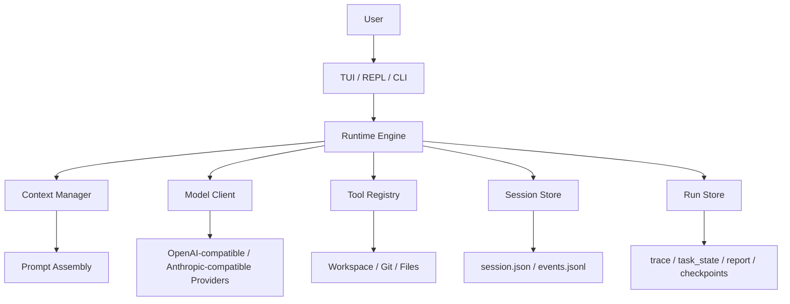

<div align="center">

# Bunny Byte

[中文](README.md) | [English](README.EN.md)

**面向本地代码仓库的终端 Coding Agent**

Bunny Byte 提供 TUI / REPL / CLI 三种交互方式，支持受控工具调用、会话恢复、任务规划、长期记忆和本地运行留痕。  
项目重点不是“把模型接到终端”，而是把本地 Agent 的可控性、可恢复性和可观察性做完整。

</div>

<p align="center">
  
</p>

> BunnyByte is AI and can make mistakes. Please double-check responses.

## 概述

Bunny Byte 运行在本地仓库中，通过受控工具完成代码检索、命令执行、文件修改、任务拆解与上下文管理。  
运行过程中产生的 session、event、trace、checkpoint、report 和 memory 数据都会保存在本地，便于恢复、审计和复盘。

## 核心能力

| 能力 | 说明 |
| --- | --- |
| 模型接入 | 支持 OpenAI Responses API 与 Anthropic 风格接口；`provider` 负责配置选择，`protocol` 负责请求协议。 |
| 故障切换 | 主 provider 5xx / 限流 / 超时时自动改用 `fallback` 备用链，切换过程写入 trace 并在界面提示；详见 [配置](docs/configuration.md)。 |
| 工具调用 | 优先使用 provider 原生 tool calling；同时保留兼容旧后端的 fallback。 |
| 会话管理 | 支持 `/history`、`/resume`、`/fork`、`/rollback`、`/compact`。 |
| 任务编排 | 支持 plan mode、todo ledger、`ask_user`、`Explore` / `worker` 子 agent。 |
| 记忆系统 | 提供 working memory、daily logs、durable topics，以及 `/remember`、`/dream`。 |
| 跑分基准 | `bunny bench` 用真实模型在 8 个固定任务上打分（通过率、步数、token、耗时），结果与历史写入 `benchmarks/results/`；详见 [跑分基准](docs/benchmark.md)。 |
| 安全控制 | 支持 approval policy、sandbox，以及写文件前 fresh read 校验。 |
| 运行留痕 | 落地 session JSON、events JSONL、trace、task state、report、checkpoint。 |

## 界面示例

### 工具执行与任务过程

<p align="center">
  
</p>

同一界面内可以查看模型输出、工具调用、命令执行结果和子任务状态。

### 计划模式与记忆状态

<p align="center">
  
</p>

计划模式下可以同步查看 todo 进度、子 agent 状态和 memory 相关信息。

## 架构



完整版本见 [Architecture](docs/architecture.md)。

<details>
<summary>展开查看完整架构图预览</summary>

```text
┌────────────────────────────────────────────────────────────────────────────────────┐
│                              ENTRY LAYER (入口层)                                    │
│  ┌──────────┐  ┌──────────┐  ┌──────────┐  ┌──────────┐  ┌──────────────────────┐ │
│  │  bunny   │  │bunnybyte │  │   bb     │  │bunnybyte │  │  bunny "one-shot"    │ │
│  │  (TUI)   │  │  (TUI)   │  │  (TUI)   │  │  --repl  │  │  --resume latest     │ │
│  └────┬─────┘  └────┬─────┘  └────┬─────┘  └────┬─────┘  └──────────┬───────────┘ │
│       └──────────────┴─────────────┴─────────────┘                │              │
│                              │                                     │              │
│                     bunnybyte.cli:main()                            │              │
│                     argparse → runtime.init →                      │              │
│                     TUI / REPL / one-shot 分支                      │              │
└──────────────────────────────────┬─────────────────────────────────────────────────┘
                                   │
                                   ▼
┌────────────────────────────────────────────────────────────────────────────────────┐
│                              CORE RUNTIME (核心运行时)                               │
│                                                                                     │
│  ┌─────────────────────────────────────────────────────────────────────────────┐   │
│  │                          BunnyByte (core/runtime.py)                         │   │
│  │                                                                              │   │
│  │  ┌──────────────┐  ┌──────────────┐  ┌──────────────┐  ┌──────────────────┐ │   │
│  │  │ SessionState │  │ WorkspaceCtx │  │  Permission  │  │  Tool Profiles   │ │   │
│  │  │   Mixin      │  │  (git snapshot│  │   Checker    │  │  (default/plan/  │ │   │
│  │  │              │  │   +docs)     │  │              │  │   readonly/worker)│ │   │
│  │  └──────────────┘  └──────────────┘  └──────────────┘  └──────────────────┘ │   │
│  │                                                                              │   │
│  │  ┌──────────────┐  ┌──────────────┐  ┌──────────────┐  ┌──────────────────┐ │   │
│  │  │  CompactMgr  │  │ ContextMgr   │  │  PlanMode    │  │   WorkerManager  │ │   │
│  │  │  (history    │  │  (prompt     │  │  Controller  │  │   (subagent      │ │   │
│  │  │   compaction)│  │   assembly)  │  │              │  │    lifecycle)    │ │   │
│  │  └──────────────┘  └──────────────┘  └──────────────┘  └──────────────────┘ │   │
│  │                                                                              │   │
│  │  ┌──────────────┐  ┌──────────────┐  ┌──────────────┐  ┌──────────────────┐ │   │
│  │  │  ReadLedger  │  │  TodoLedger  │  │  RunStore    │  │  SessionEventBus │ │   │
│  │  │  (file read  │  │  (task todo  │  │  (evidence   │  │  (event stream   │ │   │
│  │  │   dedup)     │  │   tracking)  │  │   persistence)│  │   persistence)  │ │   │
│  │  └──────────────┘  └──────────────┘  └──────────────┘  └──────────────────┘ │   │
│  │                                                                              │   │
│  │  ┌──────────────────────────────────────────────────────────────────────┐   │   │
│  │  │                    Engine (core/engine.py)                            │   │   │
│  │  │                                                                       │   │   │
│  │  │   run_turn() ─── 生成器，每次 yield 一个事件                           │   │   │
│  │  │                                                                       │   │   │
│  │  │   ┌──────────────────────────────────────────────────────────────┐   │   │   │
│  │  │   │                  TURN CONTROL LOOP                           │   │   │   │
│  │  │   │                                                              │   │   │   │
│  │  │   │   1. ContextManager 组装 prompt                              │   │   │   │
│  │  │   │   2. Provider Client 发起请求 (流式)                          │   │   │   │
│  │  │   │   3. 解析返回 (原生 tool call / 文本 <tool>/<final>)          │   │   │   │
│  │  │   │   4. ToolExecutor 执行工具 (含 policy + permission 检查)      │   │   │   │
│  │  │   │   5. 结果追加到 history，循环直到 <final> 或达到步数上限      │   │   │   │
│  │  │   │                                                              │   │   │   │
│  │  │   └──────────────────────────────────────────────────────────────┘   │   │   │
│  │  └──────────────────────────────────────────────────────────────────────┘   │   │
│  └─────────────────────────────────────────────────────────────────────────────┘   │
└────────────────────────────────────────────────────────────────────────────────────┘
                                   │
                                   ▼
┌────────────────────────────────────────────────────────────────────────────────────┐
│                              INFRASTRUCTURE (基础设施层)                             │
│                                                                                     │
│  ┌──────────────┐  ┌──────────────┐  ┌──────────────┐  ┌──────────────────────┐   │
│  │  Providers   │  │    Tools     │  │   Memory     │  │      Skills          │   │
│  │  (API适配)   │  │  (工具系统)   │  │  (记忆系统)   │  │     (技能系统)        │   │
│  └──────────────┘  └──────────────┘  └──────────────┘  └──────────────────────┘   │
│  ┌──────────────┐  ┌──────────────┐  ┌──────────────┐  ┌──────────────────────┐   │
│  │   Sandbox    │  │  Evaluation  │  │   Testing    │  │    Evidence          │   │
│  │  (安全隔离)   │  │  (评估系统)   │  │  (脚本化测试) │  │   (审计证据)          │   │
│  └──────────────┘  └──────────────┘  └──────────────┘  └──────────────────────┘   │
└────────────────────────────────────────────────────────────────────────────────────┘
```

</details>

代码结构大致对应：

- [`bunnybyte/tui/`](bunnybyte/tui/)：Textual 终端界面
- [`bunnybyte/core/`](bunnybyte/core/)：runtime、engine、context、session、checkpoint、worker
- [`bunnybyte/tools/`](bunnybyte/tools/)：工具注册、schema、执行入口
- [`bunnybyte/features/`](bunnybyte/features/)：memory、skills、sandbox
- [`bunnybyte/providers/`](bunnybyte/providers/)：模型 provider client
- [`bunnybyte/evaluation/`](bunnybyte/evaluation/)：评估与运行证据

## 快速开始

要求：`Python 3.10+`、`git`，以及至少一个可用的模型 provider key。

### 安装

```bash
curl -fsSL https://raw.githubusercontent.com/LISAooo1234/Bunny-Byte/main/install.sh | bash
```

安装后初始化 provider 配置：

```bash
bunny setup
bunny doctor
bunny
```

`bunny doctor` 会逐项检查 Python、配置文件、provider/模型/API key（只显示末 4 位）、真实连通性、git 仓库、sandbox 后端和 ripgrep，并检测 `.bunnybyte.toml` / `.env` 是否被 git 跟踪导致 key 泄露。每个失败项都附带可直接执行的修复建议；`--offline` 跳过网络请求，`--json` 便于脚本和 CI 使用，存在失败项时退出码为 1。

### 源码开发

```bash
git clone https://github.com/LISAooo1234/Bunny-Byte.git
cd Bunny-Byte
uv sync --dev
uv run bunny
```

可用入口：

```bash
bunny
bunnybyte
bb
bunnybyte-tui
bbtui
```

## 常用命令

### CLI

```bash
bunny
bunny --resume latest
bunny --repl
bunny "修复当前仓库里最先失败的测试"
bunny doctor            # 环境自检
bunny bench             # 跑分基准（会调用真实模型）
```

### TUI Slash Commands

- `/help`
- `/history`
- `/resume latest`
- `/fork <event|turn|#>`
- `/rollback <event|turn|#>`
- `/plan <topic>`
- `/plan-exit`
- `/skills`
- `/tool [name]`
- `/memory`
- `/working-memory`
- `/dream`

## 跑分基准

Bunny Byte 自带实测跑分：`bunny bench` 在 8 个临时 git 仓库里让真实模型完成修 bug、按 docstring 写功能、跨文件重命名、加 CLI 开关、只读问答、补丁失败后恢复等任务，
再由 shell verifier（含只在判分时才写入的隐藏测试）判定结果，输出通过率、正常收尾率、平均步数、token 和耗时，并把带版本/提交/模型指纹的结果追加到 `benchmarks/results/`，分数历史公开可查。

<<BASELINE>>

任务只有 8 道，每题 = 12.5 个百分点，单次浮动 1 题属于噪声；平均步数与 token 更能反映回归。细节见 [跑分基准](docs/benchmark.md)。

## 仓库结构

```text
bunnybyte/
├── core/        # runtime、engine、context、session、checkpoint、workers
├── tools/       # 内置工具定义与注册
├── tui/         # Textual 终端界面
├── features/    # memory、skills、sandbox
├── providers/   # model provider client
├── bench/       # bunny bench 实测跑分
└── evaluation/  # 评估与运行证据

docs/
├── configuration.md
├── skills.md
├── memory.md
├── sandbox.md
└── benchmark.md

tests/           # runtime / safety / TUI / acceptance / regression tests
```

## 文档

- [配置说明](docs/configuration.md)
- [Architecture](docs/architecture.md)
- [Skills](docs/skills.md)
- [Memory](docs/memory.md)
- [Sandbox](docs/sandbox.md)
- [跑分基准](docs/benchmark.md)
